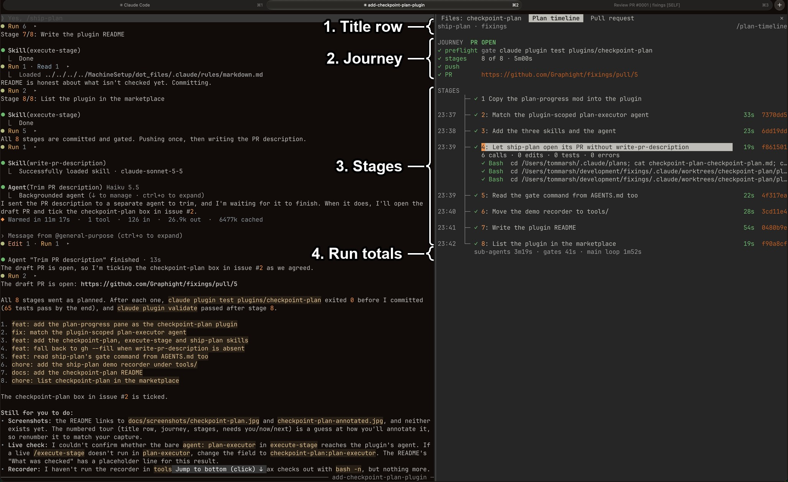
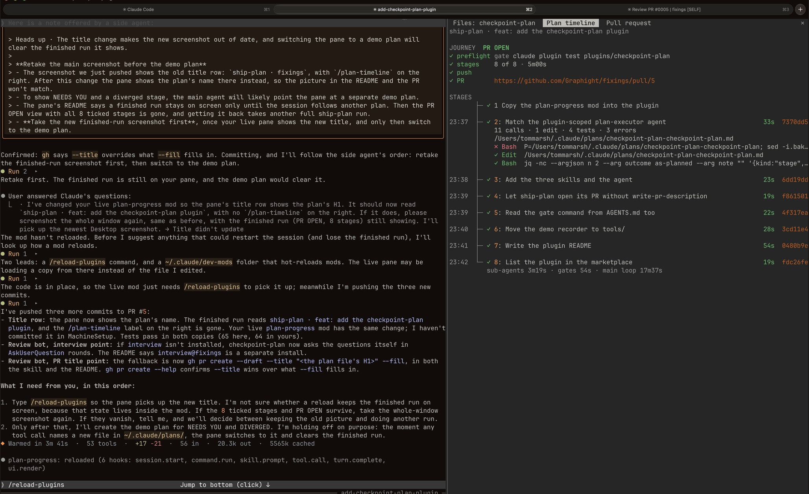
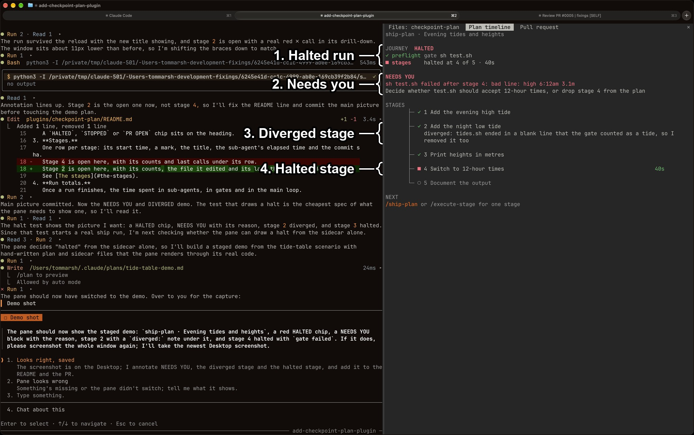

# checkpoint-plan

`checkpoint-plan` is three skills and an agent that turn a piece of work into a staged plan, run it one stage at a time or unattended, and a mod that draws the plan's progress in the `/plan-timeline` side pane.
Install it with `/plugin install checkpoint-plan@fixings`.

## What you're looking at

1. **Title row.**
   The plan file's H1, after `ship-plan` while a ship run is active or the session holds run events and after `plan` otherwise, cut at the pane's width.
   With no plan followed, the repo name stands in for the H1.
2. **Journey.**
   A preflight row with the gate command, a stages row with the count, elapsed time and, during a ship run, an estimate, and push and PR rows around a ship run.
   A `HALTED`, `STOPPED` or `PR OPEN` chip sits on the heading.
3. **Stages.**
   One row per stage: its start time, a mark, the title, the sub-agent's elapsed time and the commit sha.
   Stage 2 is open here, with its counts, the file it edited and its last three calls under its row.
   See [The stages](#the-stages).
4. **Run totals.**
   Once a run finishes, the time spent in sub-agents, in gates and in the main loop.

While a run is open or halted, `NEEDS YOU`, `NOW` and `NEXT` follow these; see [Needs you, now and next](#needs-you-now-and-next).

The same pane without the numbers:

### When a run needs you

1. **Halted run.**
   The `HALTED` chip on `JOURNEY`, and the stage the run stopped at in the stages row.
2. **Needs you.**
   The halt's reason in red and what it needs from you, moved up under `JOURNEY`.
3. **Diverged stage.**
   A stage whose executor recorded `diverged` gets its note under its title.
4. **Halted stage.**
   The stage the run stopped at, marked `■` in red.

This picture is staged: its plan and run sidecar were written by hand, and the pane drew them with its real code.

## The skills and the agent

- `checkpoint-plan` interviews you, then writes a staged plan to `~/.claude/plans/<repo>-<branch>.md`, with a commit message and a review checkpoint per stage.
  It runs the `interview` skill, which is a separate install (`/plugin install interview@fixings`), and asks in plain `AskUserQuestion` rounds when that skill is absent.
- `execute-stage` builds the first unticked stage by forking into the `plan-executor` agent on a cheap model, ticks the box and stops for your review.
- `ship-plan` runs every remaining stage unattended: a commit per stage, the gate command after each, then a push and a draft PR.
  It opens the PR with `write-pr-description` when that skill is installed (`/plugin install write-pr-description@fixings`) and `gh pr create --draft --title "<the plan file's H1>" --fill` when it is not.
  It looks for the gate command in the repo's `CLAUDE.md` or `AGENTS.md` first.
- `plan-executor` is the agent `execute-stage` forks into.
  It is not usually invoked directly.

Each stage appends a line to the run sidecar, `~/.claude/plans/<repo>-<branch>.run.jsonl`, which the pane reads.

## The pane

`/plan-timeline` opens a side pane that requests 60 columns; the engine may grant fewer, and a width you have dragged wins.
It follows the plan file the session last touched, and falls back to the plan of the branch the session was launched on.
The pane sets no background, so it follows the terminal's theme.

### The stages

The mark is `✓` in green for a finished stage, `●` in the orange fill colour with a bold title for the running one, `■` in red for a halted one and a dim `○` for a pending one.
The elapsed time is green up to the p50, yellow above it and red above the p90, and the sha is dropped when the title would have fewer than twenty cells.
A stage that diverged, was blocked or failed its gate has one more row under its title: `diverged: <note>`, `blocked: <note>` or `gate failed`.
A stage whose sub-agent has finished draws its title as a button: `1: title` for stages 1 to 9, where the digit is its hotkey while the pane holds the keyboard, and `10 title` from stage 10 up.
A press opens rows under it with its note, counts, edited files and last three calls; the same press closes them, and one stage is open at a time.
On Desktop the journey is one SVG stepper, and the open stage's note sits in a rounded box.

### Needs you, now and next

- `NEEDS YOU` shows a halt's reason and what it needs, or `no reason recorded` for a stop; after a finished run it lists the stages that diverged.
- `NOW` shows the running sub-agent's call, edit, test and error counts and its last three tool calls.
- `NEXT` names `/ship-plan` or `/execute-stage` when stages are unticked and nothing is running.
- With no run recorded the pane shows `LAST RUNS · this repo`, `YOUR STAGE TIMES` (p50 and p90, measured or stored) and a `NEXT` that names `/checkpoint-plan`.

### Feeds

Five feeds fill it: the plan file (stages and ticks), main-loop `Bash` calls (gate, commit sha, push, PR URL), the sub-agent's own calls and its `turn.complete` (counts, duration), the run sidecar, and the store (past runs).
A one-second timer redraws the pane while a stage is running or a ship run is open, and cancels itself once the pane has not drawn a running stage for five ticks.
A notification fires when a run halts, when it stops with stages unticked and no halt line, and when the PR opens.
The pane opens by itself when `ship-plan` starts, on `skill.prompt`.
A typed `/ship-plan` opens it at any width; a `Skill` call in a terminal narrower than the 144 columns the engine needs for an unasked pane gets a toast saying to widen the terminal or run `/plan-timeline`.

## Known limits

- The estimate and the p50 and p90 thresholds come from constants measured on 09 Oct 2026 (p50 1.6 minutes, p90 5.4 minutes) until ten runs are stored.
- Runs stored under the old `plan-progress` store are not migrated, so the constants apply again until ten runs are stored under this plugin.
- `execute-stage` names `agent: plan-executor`, a bare name; if a live run does not fork into the agent, the field must become `checkpoint-plan:plan-executor`.
- The plan must follow the `- [ ] N. Title` checkbox shape that `checkpoint-plan` writes; other plan files draw no stages.
- VS Code is not a target for the pane.

## What was checked

`claude plugin test` runs 65 tests in `tests/`, covering the plan parser, the sidecar, the feeds, the terminal and Desktop drawings, the redraw timer, the store and the notifications; all 65 passed.
The screenshot is this plugin's own `ship-plan` run on 2026-11-03, drawn by the source `plan-progress` mod, whose drawing code this plugin carries with only its plugin name changed.
The halted picture was staged the same day, from a hand-written plan and sidecar in the tide-table scenario that `tools/demo/ship-plan/` records.
Whether `execute-stage` forks into `plan-executor` once installed from fixings is still to be checked and recorded here.
