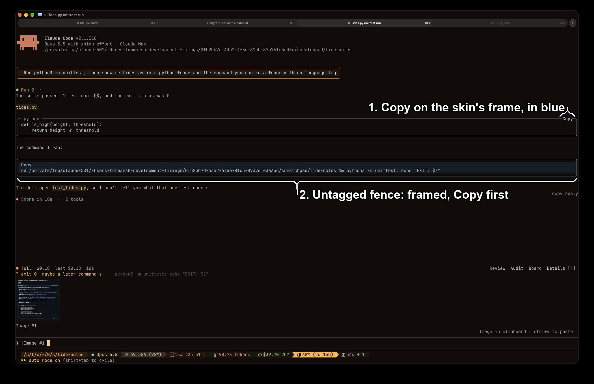

# copy-visible

`copy-visible` makes the Copy button on a reply's code blocks easy to see.
It draws the block in a blue frame, with Copy in bold blue as the first line inside it.
Install it with `/plugin install copy-visible@fixings`.

It works on top of the `skins` plugin (hellosverre/claude-skins), which adds those Copy buttons.
Without `skins` it does nothing.

## What you're looking at



1. **A code block with a language tag** (here `python`).
   With `skins` 0.5.16 it keeps the skin's grey frame, and only the Copy button turns blue.
   See [Known limits](#known-limits).
2. **A code block with no language tag.**
   The full look: a blue frame on a dark blue background, with Copy as the first line.

## If you use skins

You must, and the order matters.
`skins` and `copy-visible` both draw reply blocks, and the one listed first in `enabledPlugins` wins.
`/plugin install` puts `copy-visible` at the end of the list, below `skins`, where it draws nothing.
After installing, move its line above the `skins` line in your settings file:

```json
"enabledPlugins": {
  "copy-visible@fixings": true,
  "skins@hellosverre-mods": true
}
```

Install it at user scope, the default.
In the check below, a `--scope local` install lost to a user-scope `skins` and drew nothing.

## Options

Change the colours in `/config`.
Leave one blank to use the default.

| Option | Default | Colours |
| --- | --- | --- |
| `border` | `#7fb0d0` | the frame and the Copy button |
| `background` | `#141d26` | behind the block |

## How it behaves

Pressing Copy runs the skin's own copy, so you get exactly what the skin would copy: the block alone, without the frame.
The `copy reply` button under a reply copies the whole reply, and `copy-visible` leaves it alone.
For a block the skin did not frame (no language tag, or a tag it does not highlight, such as `text`), `copy-visible` draws the frame itself.

## Known limits

- On `skins` 0.5.16, tagged blocks keep the skin's frame and only the button turns blue.
  `copy-visible` was built against the layout of `skins` 0.5.0, and the newer layout has not been looked into.
- Replies only: Copy buttons on slash-command output and shell output keep the skin's look.
- Selecting a block with the mouse also selects the word `Copy`.
- A frame `copy-visible` draws itself has no syntax colours and never folds, so a long block shows in full.
- Tables get the blue frame too, and rows the skin has shaded keep their shading.
- The button takes clicks in fullscreen mode only.

## What was checked

- `claude plugin test plugins/copy-visible` covers the frame, the button, custom colours and a block with no tag.
- Before the port, in October 2026, a click on the blue button copied the block alone.
- Live on 2026-11-05 in Ghostty, beside `skins` 0.5.16: listed above `skins`, both blocks drew as in the picture above.
  Installed with `--scope local`, both drew exactly as the skin draws them.
- Not checked: a click in that session, a table, a `diff` block and a diagram.
