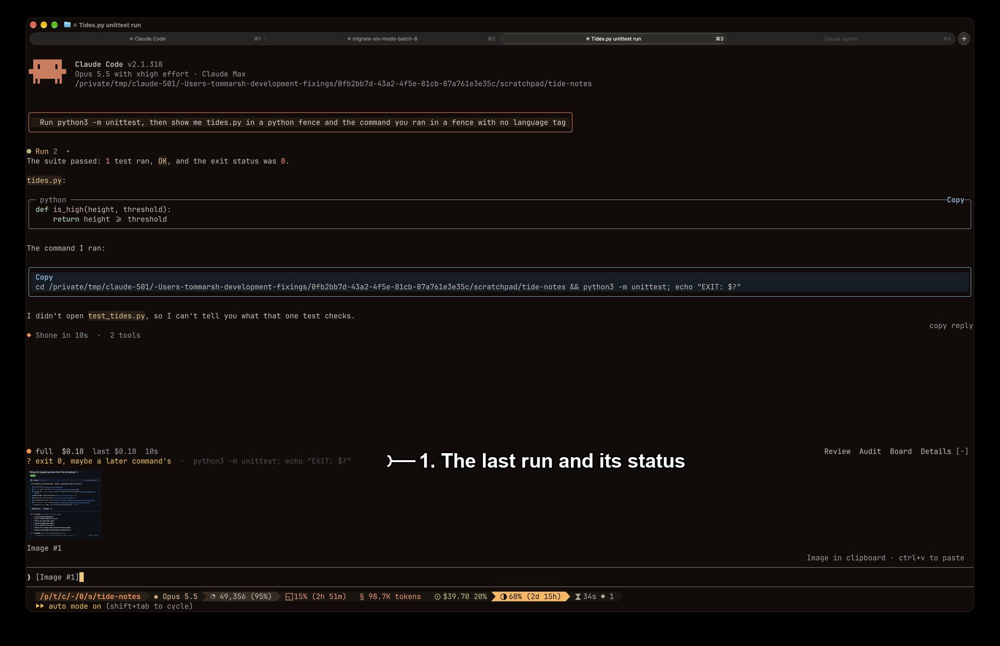

# evidence-band

`evidence-band` draws the last test or build command and its exit status in a band above the prompt.
Install it with `/plugin install evidence-band@fixings`.

## What you're looking at

1. **The last run and its status.**
   Here `? exit 0, maybe a later command's`, because the run chained `echo` after `python3 -m unittest`, so the `0` the shell reported is the `echo`'s; see [How it reads a run](#how-it-reads-a-run).

## How it reads a run

A `tool.call` hook on `Bash` matches the command against the runners in `RUNNER` in `hooks/register.tsx`, among them `npm test`, `./gradlew`, `pytest`, `make`, `claude plugin test` and a `test_*` script, wherever one stands in command position.
A failed call carries no status field, so the status is read from the error text, which starts `Exit code N`; a call that did not fail is `exit 0`.
A pipe, `;`, `||`, a lone `&` or new line after the runner means the shell reported a later command's status, or none of the runner's, so the band draws that run as `? exit 0, maybe a later command's` and not as a pass; `set -o pipefail` clears the pipe case.
Quoted text is emptied before matching, so a runner or a separator inside a commit message is not read as one.
A backgrounded, interrupted or timed-out run, and one whose non-zero status Claude Code read as no error, is drawn as `? no exit status`.

The row is stacked over the band beneath it, so `evidence-band` and `image-thumbnail` show together.

## Known limits

- The runner list is a regular expression in the module, and a run by a runner not on it is not recorded: the earlier run stays drawn, so a passing `pytest` followed by a failing `uv run pytest` leaves `✓ exit 0  ·  pytest` in the band.
- A runner inside quoted text, as in `bash -c "npm test"`, is not recorded either.
- A heredoc body is not quoted text, so a line in it that starts with a runner is read as a run.
- The band shows main-loop runs only: a Bash call from a sub-agent's loop (`agentId` set on the event) is not recorded.
- Edits made after the run are not counted, so the band can show a pass older than the code.

## What was checked

Before the port, on 11 Oct 2026, with a probe mod in a `claude -p` session: `false` resolved with the text `Exit code 1`, `sh -c 'exit 7'` with `Exit code 7`, `true` with no status field, and a `grep` with no match as a non-error carrying `returnCodeInterpretation`.
On 12 Oct 2026 the row drew in a live session's band, as `✓ exit 0` and the command.
On 2026-11-05, installed from this marketplace at local scope in a fullscreen session beside `skins` 0.5.16, the band drew `? exit 0, maybe a later command's · python3 -m unittest; echo "EXIT: $?"` above the `image-thumbnail` row, which is the picture above.
