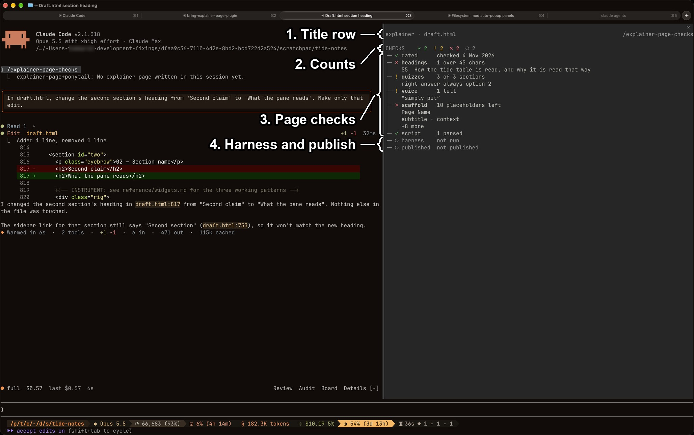
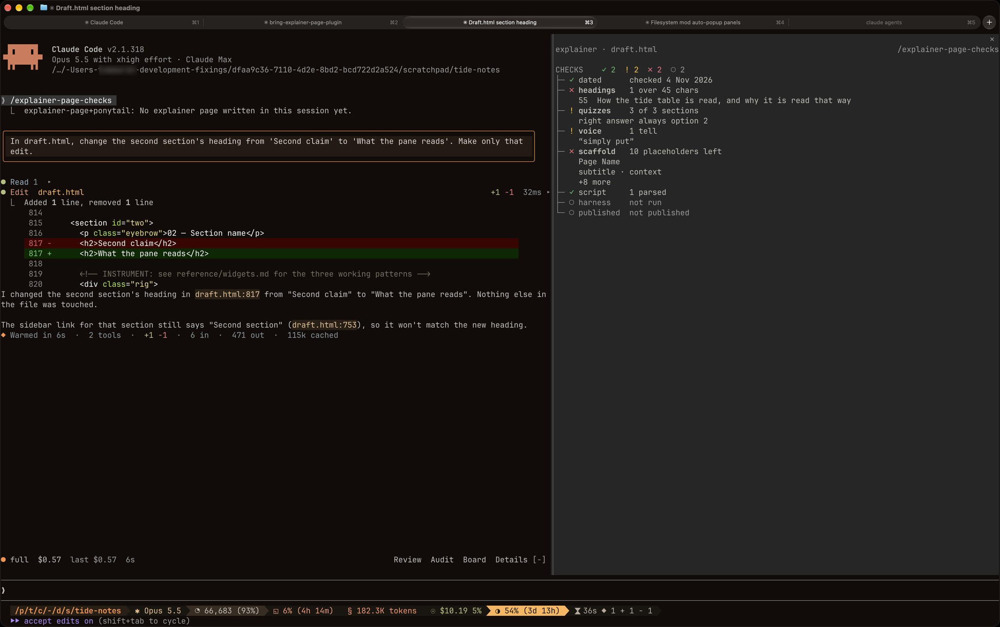

# explainer-page

`explainer-page` is a skill that builds a sleek, interactive HTML page explaining something, published as an Artifact, and a mod that draws the page's pre-publish checks in the `/explainer-page-checks` side pane.
Install it with `/plugin install explainer-page@fixings`.

## What you're looking at

1. **Title row.**
   `explainer · draft.html`, the page being followed, with `/explainer-page-checks` at the right edge.
   Before a page is written it reads `no explainer page written yet`.
2. **Counts.**
   The passed (`✓`), to-look-at (`!`), failed (`✗`) and not-yet-done (`○`) checks; a count of zero is left off.
3. **Page checks.**
   One row per check read from the page: a mark, the name and a detail, with up to three note rows under a check that has notes.
   Here `dated` passes with `checked 4 Nov 2026`, `headings` fails with the 55-character heading under it, and `scaffold` fails with its first placeholders and `+8 more`.
   See [The checks](#the-checks).
4. **Harness and publish.**
   `harness` and `published` are `○` until the widget harness has run and the page has been published.

The same pane without the numbers:

The picture is a draft in the demo's tide-notes scenario, captured on 4 Nov 2026.

## The skill

`explainer-page` turns a question into one self-contained HTML page in a fixed house style: a sticky vertical nav rail, an auto, light and dark toggle, interactive widgets that carry the argument, and a short quiz at the end of each section.
It researches before it designs, and every claim on the page has to trace to a source it read; where the code and the docs disagree, the page says so in its own dated callout.
The style lives in `skills/explainer-page/reference/scaffold.html`, with the widget patterns in `reference/widgets.md`.

## The checks

The pane follows the last `.html` file the session wrote or edited that holds the scaffold's `data-theme-set` theme toggle, so other HTML files are ignored.
`✓` is green, `!` yellow with a bold name, `✗` red with a bold name, and `○` and a skipped `–` dim.

| Check | Passes when | Read from |
| --- | --- | --- |
| `dated` | the visible text holds a date like `21 Oct 2026` and not the scaffold's `DD Mon YYYY` | the page |
| `headings` | every `h2` is at most 45 characters | the page |
| `quizzes` | every `section` has a `.quiz-opts` block with exactly one `data-right` button; a section with no quiz, or the right answer in the same slot in three or more quizzes, is a `!` | the page |
| `voice` | none of the skill's voice tells appear in the visible text; a tell is a `!` | the page |
| `scaffold` | none of the scaffold's placeholder strings are left | the page |
| `script` | every inline script parses under `node`'s `vm.Script`; external and non-JavaScript scripts are skipped | `node`, run by the mod |
| `harness` | the last main-loop or sub-agent `Bash` call running `node …harness….js` succeeded after the page's last change; skipped when the page has no `.rig` or `canvas` | `Bash` calls |
| `published` | an `Artifact` publish of this file holds the page as it is now; the row shows the URL | `Artifact` calls |

## The pane

`/explainer-page-checks` opens a side pane that requests 60 columns; the engine may grant fewer, and a width you have dragged wins.
The page is re-read after every `Write` or `Edit` of an `.html` file, after a `Bash` call whose command names the followed file, after an `Artifact` publish, and on `/explainer-page-checks`.
On Desktop the pane draws a title block, the counts as coloured chips, and one row per check with its notes indented under it.
The pane opens by itself when `explainer-page` starts, on `skill.prompt`, for a typed `/explainer-page` and for the model's `Skill` call.
A `Skill` call in a terminal narrower than the 144 columns the engine needs for an unasked pane gets a toast saying to widen the terminal or run `/explainer-page-checks`; once the pane has been opened, the engine places it from 110 columns.

## Known limits

- The mod cannot tell whether a claim is sourced; `dated` checks only that the page says when it was checked.
- The command is `/explainer-page-checks` rather than `/explainer-page:checks`, because a mod's command name allows only letters, digits, `_` and `-`.
- VS Code is not a target for the pane.

## What was checked

`claude plugin test` runs five tests in `tests/`, covering a non-scaffold page, a page that fails every page check, a clean published page, the harness and publish rows going stale after an edit, and the pane opening when the skill expands, bare or namespaced; all five passed.
The pane was seen in a live session on 2026-11-04, after an `Edit` of a draft page in the tide-notes demo scenario, which is the screenshot above.
