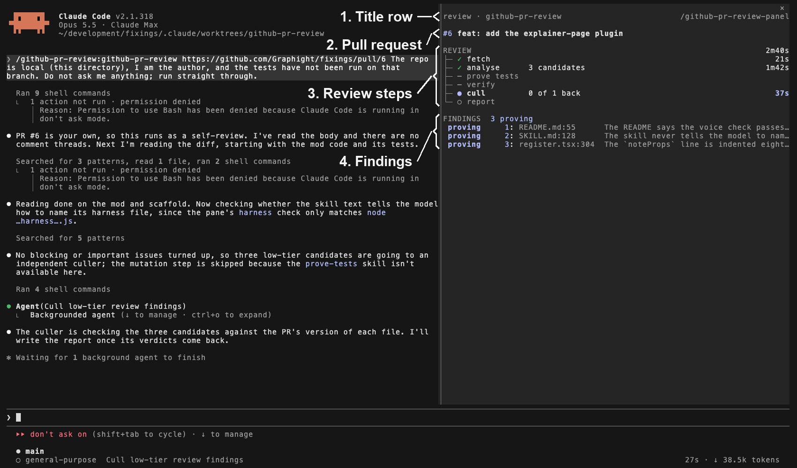
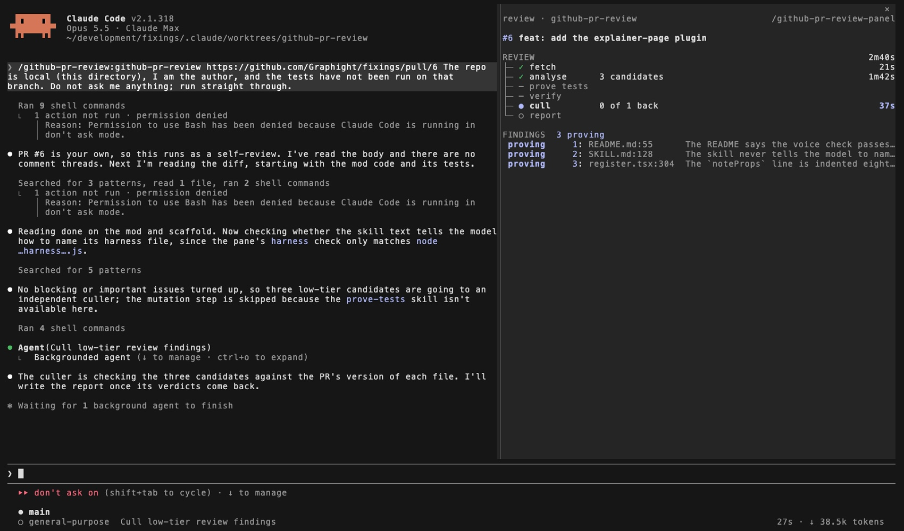
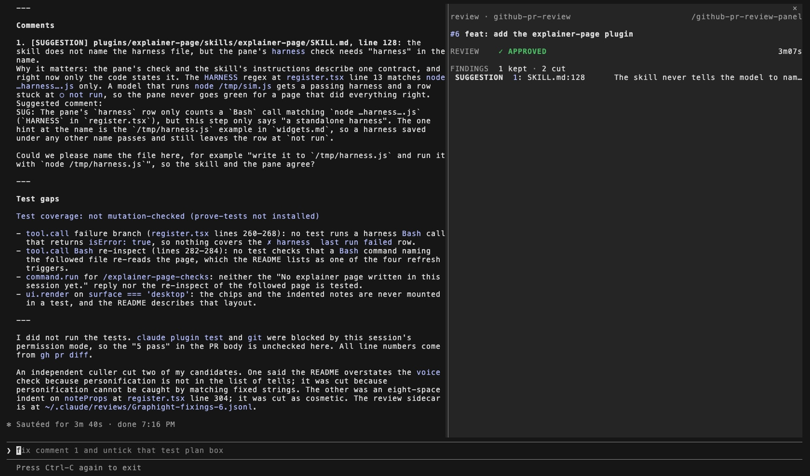

# github-pr-review

`github-pr-review` is a skill that reviews a GitHub pull request into a structured, line-referenced report, and a mod that draws the pull request, its checks and the review's progress in the `/github-pr-review-panel` side panel.
Install it with `/plugin install github-pr-review@fixings`.
It needs `gh` and `jq` on the PATH.

## What you're looking at



1. **Title row.**
   `review · <repo>` while a review sidecar is followed and `pr · <repo>` otherwise, with `/github-pr-review-panel` at the right edge.
   With no pull request and no review it reads `no pull request on this branch`.
2. **Pull request.**
   `#<number>` in the fill colour and the title in bold, truncated at the row's end.
   A `CHECKS` row follows when the PR has checks; fixings has no CI, so #6 shows none.
3. **Review steps.**
   The six-row spine; here `prove tests` and `verify` are skipped (`–`) and `cull` is running at `0 of 1 back`.
4. **Findings.**
   One row per finding not yet cut; here three are proving.

The same panel without the numbers:



The finished review folds to one row, and the report follows in the chat:



## The skill

`github-pr-review` (model `opus`) fetches a pull request, raises candidate findings, verifies each one against the code, culls what does not hold up, and writes a report of what is left, each finding with a tier (`BLOCKING`, `IMPORTANT`, `SUGGESTION`, `NIT` or `QUESTION`) and a `path:line`.
Suggested comments are fenced with the `markdown` tag.
It writes a sidecar of JSON lines as it goes, which is what the panel draws.

When the PR adds or changes tests, the skill hands them to the `prove-tests` skill for a mutation check.
Without `prove-tests` in the session's skill list the step is skipped, no `prove` line is written, and the report prints `Test coverage: not mutation-checked (prove-tests not installed)`.

## The panel

`/github-pr-review-panel` opens a side panel that requests 60 columns; it needs the fullscreen TUI, as an inline session has no room for it.
`CHECKS` counts the passed (`✓`), pending (`●`) and failed (`✗`) checks, leaves a count of zero off, and names the failed checks in red and then the pending ones, or reads `all passed`; a cancelled check counts as failed, and the row is left out when `gh` fails, prints no array or reports no checks.
`REVIEW` is a spine of six rows, `fetch`, `analyse`, `prove tests`, `verify`, `cull` and `report`, each with a mark and its elapsed time: `✓` for a finished step, `●` in the fill colour and a bold name for the running one, a dim `○` for a pending one, and a dim `–` for a step skipped because a later step has started without it.
The `analyse` row reads `n candidates` from the findings raised before the next step, the `prove tests` row reads `n mutants`, and a running step with a sub-agent out reads `n of m back`.
Once a `done` line is read, the block folds to one row: `REVIEW`, a `✓`, the verdict in bold (green for `APPROVED`, yellow for `COMMENT`, red for `CHANGES REQUESTED`) and the total time at the right edge.
`FINDINGS` has a title row that counts `n kept`, `n proving` and `n cut`, then one row per finding that has not been cut, ordered by tier and then by path.
A finding with no verdict is dim, under a `proving` tag; a kept one is at full strength under its tier, with `BLOCKING` in red and `IMPORTANT` in yellow.
Each row's `file:line  claim` text is a Button, with the digits `1` to `9` as hotkeys on the first nine rows and no hotkey from the tenth.
A click on it, or the digit while the panel holds the keyboard, opens rows under it with the full `path:line` (truncated at its start), the claim wrapped to three rows, and for a kept finding the verdict's `why` behind a green `✓`; the same press closes them, and one finding is open at a time.
`MUTANTS` counts the mutants `killed`, `wrong reason` and `survived`, and is left out until a `mutant` line is read.
On Desktop the panel draws the title block with the PR number, then `CHECKS` as coloured chips; `REVIEW` is one SVG timeline scaled to the panel, `FINDINGS` are Button rows with a tier chip, and `MUTANTS` are a bar sized by count.

The panel opens by itself in two cases: a main-loop `Bash` call whose command contains `gh pr create` and whose result holds a `github.com/.../pull/<n>` URL, and the start of the `github-pr-review` skill, on `skill.prompt`, which fires for a typed `/github-pr-review` and for the model's `Skill` call.
A typed `/github-pr-review` counts as the person asking, so the panel opens at any width; for a `gh pr create` or the model's `Skill` call, in a terminal narrower than the 144 columns the engine needs for an unasked panel, a toast reads `Widen the terminal or run /github-pr-review-panel`.
Once the panel has been opened, the engine places it from 110 columns.
`/github-pr-review-panel` itself resolves the current branch's pull request with `gh pr view --json number,title,url`.

The checks come from `gh pr checks <url> --json name,bucket`, run with a 10 s timeout, and the exit code is not read, because `gh` prints the array on exit 0, 1 and 8.
For a pull request taken from a `gh pr create` result, a 30 s timer re-runs it, and a result that is not an array counts as pending for the first four periods, because `gh` prints `no checks reported` for a few seconds after the pull request opens.
The timer stops when no check is pending, when the panel has not drawn for five periods, or, for a new pull request, on the fifth period with no array; a repository with no CI is polled for two minutes and no longer.
One notification per pull request reads `#<n> checks all passed` or `#<n> checks failed: <names>`, sent when the checks settle with at least one reported.
A read that fails while a check was last seen pending leaves those checks drawn and the timer running.
A pull request loaded by `/github-pr-review-panel`, or read from a review sidecar's `pr` line, is polled only if that first read finds a check pending.

## The sidecar

The review is fed by `~/.claude/reviews/<owner>-<repo>-<number>.jsonl`, which the skill creates empty in its Step 0 and appends to through `scripts/sidecar.bash`.
The panel follows the sidecar whose path the session last named in a tool call, found by matching `/.claude/reviews/<name>.jsonl` in the call's input; sub-agent calls reach the same hook.
It re-reads the file after each call that names it, which is why every append carries the path written out in full.
A line that does not parse, or whose `kind` is not one of the six below, is skipped.

```
{"kind":"pr","number":214,"title":"...","url":"https://github.com/o/r/pull/214","head":"9f2c1ab"}
{"kind":"step","name":"fetch"}
{"kind":"finding","id":1,"tier":"BLOCKING","path":"src/a.ts","line":42,"claim":"..."}
{"kind":"verdict","id":1,"kept":true,"why":"..."}
{"kind":"mutant","test":"...","result":"killed"}
{"kind":"done","verdict":"CHANGES REQUESTED"}
```

- `step` has a `name` of `fetch`, `analyse`, `prove`, `verify`, `cull` or `report`; a step runs from its line until the next `step` or `done` line.
- `finding` has an `id` the skill numbers from 1, and a `tier` of `BLOCKING`, `IMPORTANT`, `SUGGESTION`, `NIT` or `QUESTION`.
- `verdict` names a finding by `id`; `kept: false` cuts it, and `kept: true` keeps it with a `why`.
- `mutant` has a `result` of `killed`, `wrong-reason` or `survived`.
- `done` has a `verdict` of `APPROVED`, `COMMENT` or `CHANGES REQUESTED`.

A title, path, claim, `why` or test name reaches `jq` through a quoted heredoc, one value per line, because the shell runs backticks and `$(...)` inside a double-quoted argument.
A survived mutant is written as a `finding` with a kept `verdict`.
`prove-tests` writes `mutant` lines when given `--sidecar <path>`, which the skill hands it; without the argument it writes no file.
The agents out and back are not written to the sidecar: a main-loop `agent.spawn` while a step is running counts one out for that step under the `agentId` it answers, and a `turn.complete` carrying that id counts it back.
A call that names another sidecar, or the start of `github-pr-review`, clears the review and the pull request that were drawn.

## Known limits

- A step's time starts when the panel reads the step's line, so a line appended late gives a short step.
- The panel has no figure for how many mutants are still to come.
- While the `prove` step has an agent out, its row shows `n of m back` and not the mutant count.
- The digits are positions in the list, so a digit names a different finding after one above it is cut; findings from the tenth open by click only.
- A review's sidecar is followed only once a tool call names its path.
- `/github-pr-review-panel` run during a review replaces the drawn PR with the current branch's, until the next append to the sidecar restores the `pr` line's.
- A PR's checks are polled only while the panel keeps drawing, and a new PR with no checks reported is polled for four periods.
- The spine is drawn from the skill's `step` lines, so a review whose skill run writes none shows no progress; without `jq` on the PATH every append but `init` fails, and the review keeps going with the panel at six pending steps.
- Two runs on the same PR can disagree: on fixings #6 one run kept four findings (`COMMENT`, filed as #7) and the other kept one (`APPROVED`) without raising a bug the first had found, so one `APPROVED` does not rule out bugs.
- Agents are counted only from spawns with no `parentAgentId` made while a step is running.
- VS Code is not a target for the panel.

## What was checked

All on 4 Nov 2026.
`claude plugin test plugins/github-pr-review` runs 31 tests, with `gh` and the sidecar answered by hooks beneath the panel; 31 pass, 0 fail.
`npx -p typescript tsc --noEmit -p plugins/github-pr-review` exits 0.
Two live interactive runs of `/github-pr-review` on fixings PR #6, with only this plugin loaded (`--setting-sources project,local --plugin-dir`) and no `prove-tests` skill, wrote every sidecar kind the skill writes (`pr`, `step`, `finding`, `verdict`, `done`) and no `prove` step, and the report printed the not-mutation-checked line.
In the second, fullscreen run the panel opened on the typed command and drew the spine, the findings and the folded verdict, which are the screenshots above.

The demo recorder in `tools/demo/github-pr-review/` fills the panel from a hand-made sidecar with `mutant` lines, and the panel drew `4 mutants` on the `prove tests` row and `killed 3 · wrong reason 1` on the `MUTANTS` row.

Not checked live: `mutant` lines written by `prove-tests` itself, the Desktop layout, and check polling after `gh pr create`.
