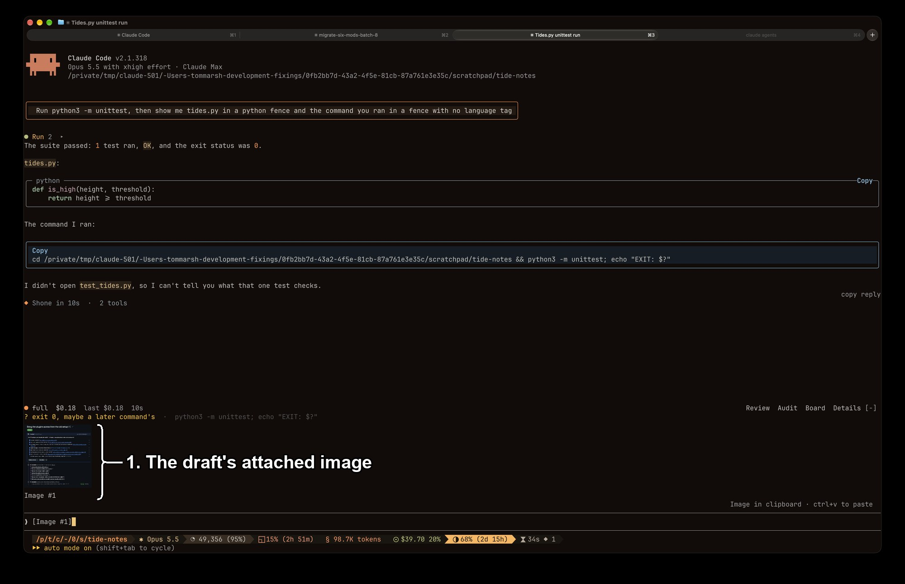

# image-thumbnail

`image-thumbnail` draws a thumbnail of each image attached to the draft in a band above the prompt.
Install it with `/plugin install image-thumbnail@fixings`.

## How it finds the picture

A `session.start` hook starts a 500 ms `$.clock.every` timer that reads the draft with `$.prompt.read()` and keeps one entry per `[Image #N]` marker.
Claude Code saves each pasted image as `<root>/<project>/<session id>/images/<n>.png`, where `<root>` is `/tmp/claude-<uid>`, or `<CLAUDE_CODE_TMPDIR>/claude-<uid>` when that variable is set.
The mod finds that file by listing `<root>` for the project folder that holds it, because the project folder is named for a working directory that can change during a session.
`sips` reads the picture's pixel size.
A marker whose file is not there yet is looked up again on each poll, ten polls at most.
One poll runs at a time.
The mod writes and removes no files.

## What you're looking at

1. **The draft's attached image.**
   The picture behind the draft's `[Image #1]` marker, with the marker's name beneath.

The band draws the picture eight rows tall, or as many rows as the band's `maxRows` leaves after the name's row, with its width taken from the picture's proportions, and the marker's name beneath.
Each picture is capped at an equal share of the band's width, and its rows shrink with it, so the pictures of one draft fit side by side.
An entry with no picture is drawn as a text chip.
The row is stacked over whatever band is beneath it, so `image-thumbnail` and `evidence-band` show together.

## Known limits

- macOS only, because the mod runs `sips`; on another system a picture draws as a chip.
- A terminal without the kitty graphics protocol draws the `alt` text.
- The thumbnail appears up to half a second after the paste.
- A collapsed band draws nothing until `ctrl+x ctrl+a` opens it.

## What was checked

On 12 Oct 2026 the cache path above was measured as `/private/tmp/claude-501/<project>/<session id>/images/1.png` to `9.png`, with the files still there after the prompt was submitted.
An image paste raised no `prompt.edit`.
The thumbnail drew in the band in a fresh session.
The band hook was called in a fresh session where `evidence-band` had no run to show, 7 times in the first minute, and was never called in a session where it had one.
The file is written before the prompt is sent: in that session `1.png` to `6.png`, `10.png` and `11.png` belong to images that were pasted and never sent.
`7.png` and `9.png` were created in the second their prompts were sent, and there is no `8.png`; the cause of neither is known.
The `CLAUDE_CODE_TMPDIR` layout is taken from the environment variable reference and has been run only under `claude plugin test`.
Not checked: whether a dragged image file is cached as `<n>.png` the same way, and how many milliseconds after the paste the file exists.
On 2026-11-05, installed from this marketplace at local scope in a fullscreen Ghostty session beside `skins` 0.5.16, an image pasted into an unsent draft drew as a thumbnail with `Image #1` beneath, under the `evidence-band` row, which is the picture above; so the cache lookup works in a live session.
