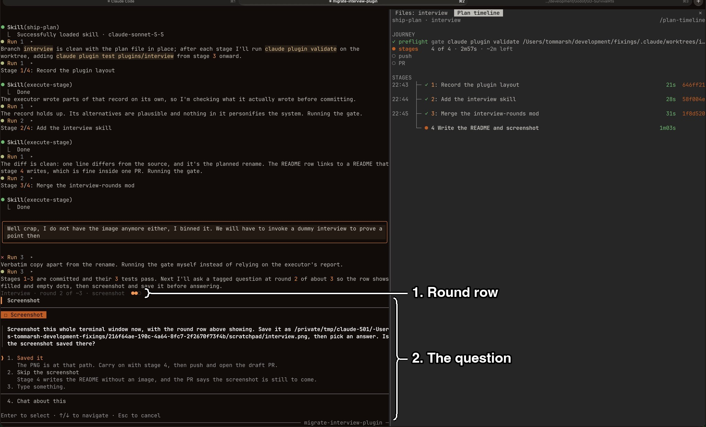

# interview

`interview` is a skill that interviews you in `AskUserQuestion` rounds until every decision behind a piece of work is settled, and a mod that draws which round each question belongs to above the dialog.
`checkpoint-plan` and `write-proposal` run it before they write anything down; you can also ask for it, e.g. "interview me on this".
Install it with `/plugin install interview@fixings`.

## What you're looking at

1. **Round row.**
   `Interview · round 2 of ~3 · screenshot ●●○`: the round, the skill's estimate of how many rounds there will be, the topic, and a dot per round, filled up to the current one.
   See [The round row](#the-round-row).
2. **The question.**
   Claude Code's own `AskUserQuestion` dialog, which the hook leaves untouched.
   See [The skill](#the-skill).

## The skill

The skill maps the work as a design tree and asks the whole frontier, every decision whose prerequisites are settled, in one round.
Facts come from the codebase or a tool, never from you; the questions are about behaviour, not implementation.
Each round puts a recommended option first, and every interview includes one scope question with `multiSelect: true` naming adjacent work you may want included.
Before round one it says how many rounds to expect.
It ends when the frontier is empty, without asking you to confirm the decisions: the skill that ran it writes them into its plan or proposal for you to review there.

## The round row

The skill tags each `AskUserQuestion` call with `metadata: { source: "interview:<n>/<N>:<topic>" }`, and a `ui.render` hook on the `AskUserQuestion` component reads it as `metadataSource` and draws the row above the engine's dialog.
A call with no such tag, as from any other skill, draws untouched.
The count is the skill's estimate; a round past it raises the count to the round, so the dots never show fewer than the round.

## Known limits

- The mod keeps no state, so it draws only the tag of the question open now, with no record of earlier rounds.
- The tag comes from the skill's instructions, not from code, so a call sent without it draws no row.

## What was checked

`claude plugin test` runs three tests in `tests/`, covering a tagged question, a round past the count, and an untagged question.
The row was seen in live sessions on 2026-11-03: `Interview · round 1 of ~1 · scope ●` above a `checkpoint-plan` interview question, and `Interview · round 2 of ~3 · screenshot ●●○` above a deliberate tagged question during a `ship-plan` run, which is the screenshot above.
