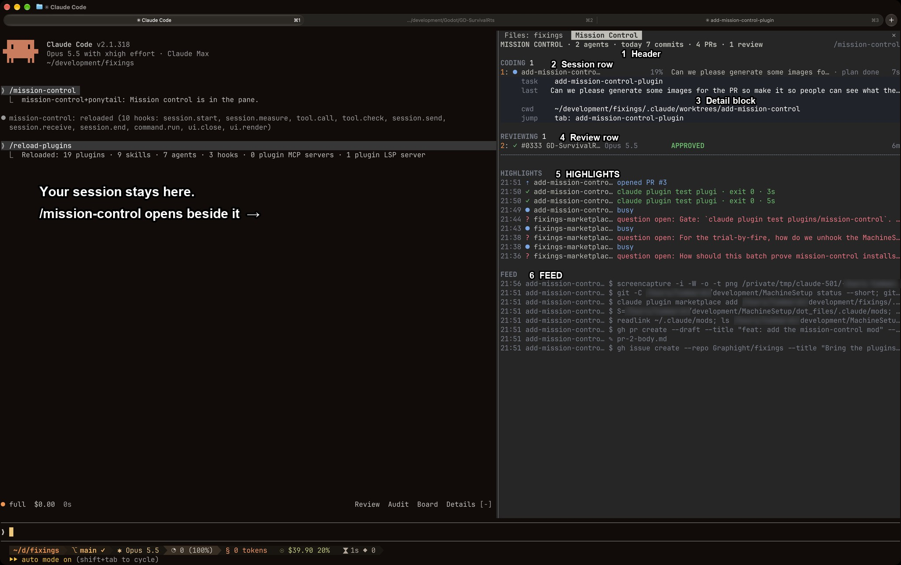

# mission-control

`mission-control` lists the other Claude Code sessions on this machine in the `/mission-control` side pane, which requests 90 columns.
The pane opens only on the command.
Install it with `/plugin install mission-control@fixings`.

## What you're looking at

1. **Header.**
   How many other sessions are running, and today's tally of your commits, PRs and finished reviews.
   See [Header and warnings](#header-and-warnings).
2. **A session row.**
   One row per session, grouped by what it is doing: NEEDS YOU (waiting on you, or stuck), CODING, and REVIEWING.
   The dot's colour is the session's status, followed by its context fill, its task, its plan stage and the time since its transcript last changed.
   See [Rows](#rows).
3. **The detail block.**
   Pressing a row, or its number, opens the task, your last prompt (or the question the session is asking), where it runs and how to jump to it.
   A session waiting on a question or a permission gets buttons to answer it from here.
   See [The detail block and its controls](#the-detail-block-and-its-controls).
4. **A review row.**
   A session reviewing a PR shows its current step, then its verdict.
   See [Rows](#rows).
5. **HIGHLIGHTS.**
   The moments worth noticing across every session, newest first: questions opened, commits, PRs, test runs with their exit status, and CI turning green or red.
   See [HIGHLIGHTS and FEED](#highlights-and-feed).
6. **FEED.**
   The raw stream of the latest file edits and shell commands across sessions.
   See [HIGHLIGHTS and FEED](#highlights-and-feed).

The sections below say exactly where each of these comes from.

## What the pane reads

After `/mission-control`, a 5 s timer runs `claude agents --json`, drops this session, and tails the last 256 KiB of each transcript.
After a reload the timer restarts when the pane had been opened.
Each session running this mod also writes a self-report to `~/.claude/mission-control/live/<session id>.json`: its context fill, the main loop's running tool, and any open question or permission prompt.
The file is removed when that session ends.

## Header and warnings

The header reads `MISSION CONTROL · N agents · today C commits · P PRs · R reviews`, and the tally refreshes once a minute.
Commits are `git log --since=<local midnight> --author=<git user.email> --all` over every checkout a session used today, remembered in the store under the local date and counted once per hash.
PRs are `gh search prs --author=@me --created=>=<local midnight>`, with midnight passed as a UTC timestamp so the count starts where the commit count starts.
Reviews are the review sidecars under `~/.claude/reviews` that hold a `done` line and were written since local midnight.
A source that fails counts as 0.

Under the header, one `⚠ mods load from <repo> on <branch>, not <main>` or `⚠ … N behind origin/<main>` line appears for each git top level holding a `CLAUDE_CODE_PLUGIN_DIRS` folder that is off its default branch or behind its local origin ref (no fetch).
The warnings are rechecked once a minute, and the previous lines stay drawn while the recheck runs.

## Rows

Sessions sit in NEEDS YOU (waiting or stuck), CODING, and REVIEWING (names starting `Review PR #`), one aligned row each: a glyph coloured by status, name, model (`Opus 5.5`), ctx, task, and age since the transcript's last write.
Sessions that share a git top level get an amber `×N` badge in the name column.
The ctx column is the context percent from each session's own self-report file, amber from 70% and red from 90%, so it is blank for a session not running this mod.
The task is the `ai-title`, or the last prompt where the title only repeats the session name, as it does once a session is renamed.
A waiting row shows `input needed`, or `permission: <Tool>` while a permission prompt is open.
A row whose self-report names a running tool reads `running $ <command, 24 characters> · Nm` (or `running <Tool> · Nm`) in blue.
A busy session counts as stuck once one tool has run past 30 minutes, or, with no tool running, once its transcript has had no write for 10 minutes; it moves to NEEDS YOU in amber with its running text or `quiet Nm`.
A coding row ends with ` · stage k of m` or ` · plan done` when `~/.claude/plans/<repo>-<branch>.md` exists for its checkout.
A `Review PR #<n> | <repo>` row shows the current step or the final verdict from `~/.claude/reviews/*-<repo>-<n>.jsonl`, and the `verify` step reads `verify · n of m back`.
A row with a PR ends with ` · CI ✓`, ` · CI ✗ N failing` or ` · CI ● running`, from `gh pr view --json number,statusCheckRollup` for the checkout's branch PR or a review's numbered PR, read once a minute per checkout and PR.

A session entering waiting or stuck raises one notification, from the pane's own polls only; the first poll after opening raises none.

## HIGHLIGHTS and FEED

HIGHLIGHTS lists the latest 20 moments, newest first, each as clock time, icon, agent and text coloured by kind, with a row younger than one poll shaded.
The moments are status changes (started, `input needed` or `question open: <question>`, `no transcript write for Nm`, done, ended), each new `git commit` (sha and subject), `gh pr create` (PR number), test or build command with its exit status and duration (`npm test · exit 2 · 5s`), review step and verdict, and a PR's CI turning `passed` or `failed: <checks>` after its first reading.
A flip between busy and idle, which every turn makes, is left out.
The icon is `?` for a question, input or permission, `⎇` for a commit, `⇡` for an opened PR, `✗` for a failure, `✓` for a success, and `●` otherwise.
FEED lists the latest 8 file edits (`✎ <file>`) and Bash commands (`$ <first line>`) found in the tails, newest first.
The first poll after opening records nothing in either section, so the backlog in each tail stays out.

## The detail block and its controls

Pressing a row, or its digit in the focused terminal pane, opens its detail: `task`, `last` (the last prompt, or the open question while the session waits), `shares` (the checkout and the sessions sharing it), `cwd`, and `jump` (`tab: <name>` or `claude attach <id>`).
On desktop and in the terminal (`j`), `jump` is a button that drives Ghostty through `osascript`: for an interactive session it focuses the Ghostty terminal whose tty matches `ps -o tty= -p <pid>`, and for a background session it opens a Ghostty tab in the session's cwd that runs `claude attach <id>`.
A failed `osascript` raises a `No Ghostty tab found for <name>` (or `opened for`) toast; mobile shows `jump` as text.
The desktop detail adds `ctx` (`42% of 1M · Opus 5.5`) and `ci` (`PR #25 CI failing: e2e`), and its `task` carries the plan stage.

An open row also carries controls that send a message to that session through `$.session.send`:

- A waiting session with an open `AskUserQuestion` shows the question with its options as buttons (`a` to `d` in the terminal) and a reply box; the answer fills the question, and the tool returns once every question has one.
- A waiting session with an open permission prompt shows the whole command under `asks`, with Allow once (`y`) and Deny (`n`).
- An idle session shows a reply box whose text is submitted there as a new prompt.

After a delivered send, the row shows what was sent until the next poll, and the desktop hides the controls meanwhile.
An allow or deny names the command the pane showed.
The receiving session acts on it only when that command's prompt is still open and `claude agents` lists the session as `waiting`, and drops the message otherwise.
An allow re-runs that call with that exact tool and input allowed once, and a deny returns `Denied from Mission Control` to the model.

## The token

Each pane message carries the token in `~/.claude/mission-control/token`, 32 hex characters made on first need, and a receiving session acts only on a message that carries it.
Every session running the mod applies three checks around it:

- A tool result whose text holds the token is withheld from the model.
- A message the model sends with its SendMessage tool is refused when its text holds the token or parses as JSON with an `mc` field.
- A received message whose origin lacks the `mission-control` plugin stamp is passed to the model as is and never acted on.

The plugin stamp is a field the sending process sets, and the output check matches only the raw token.
A session that can run arbitrary commands can still read the token through a transform such as `rev` and write a message to another session's socket directly with a forged plugin field, so pane answers rest on no such session running.

## mission_status

Every session running the mod has a `mission_status` chat tool that answers one line per lane (`CODING: fix-export (Fix the export, PR #25 CI failing: e2e, ctx 91%, 0s)`) and a `Recent:` line for each of the latest 10 highlights.
While the pane is closed it refreshes first, and that refresh raises no notifications.

## Desktop and mobile

On desktop the pane is drawn from flex boxes, with an Svg glyph per row and a ring for the context fill.
Mobile leaves out the model, the reply boxes and FEED, and shows the latest 4 highlights.
