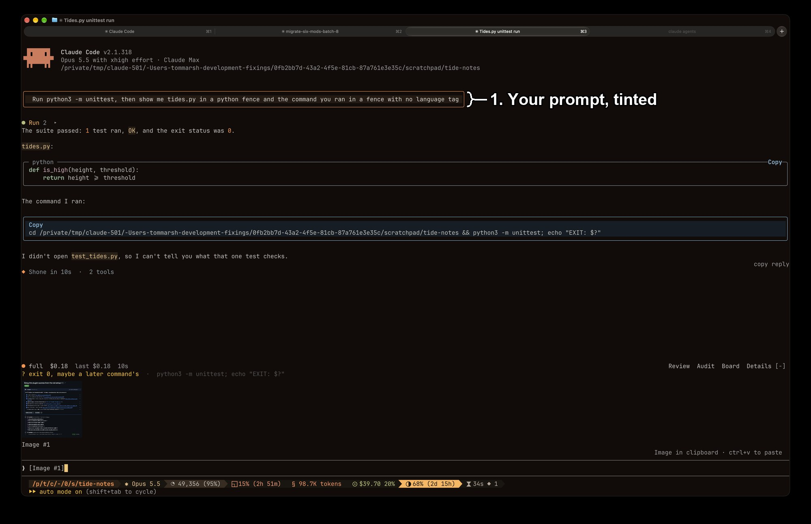

# prompt-tint

`prompt-tint` draws the prompts you type in an orange box on a dark brown background, so they stand out from the rows around them.
Install it with `/plugin install prompt-tint@fixings`.

## What you're looking at



1. **Your prompt.**
   An orange border on a dark brown background.
   Everything else keeps its usual look.

## If you use skins

The `skins` plugin (hellosverre/claude-skins) draws your prompts too.
When both are installed, the one listed first in `enabledPlugins` wins.
`/plugin install` puts `prompt-tint` at the end of the list, below `skins`, so after installing, move its line above the `skins` line in your settings file:

```json
"enabledPlugins": {
  "prompt-tint@fixings": true,
  "skins@hellosverre-mods": true
}
```

Install it at user scope, the default.
In the check below, a `--scope local` install lost to a user-scope `skins` and drew nothing.

## Options

Change the colours in `/config`.
Leave one blank to use the default.

| Option | Default | Colours |
| --- | --- | --- |
| `border` | `#ff8f40` | the box around the prompt |
| `background` | `#241a12` | behind the prompt |
| `text` | `#d8d4cc` | the prompt text |

## What it leaves alone

Only prompts you type are tinted.
Notifications, messages from teammates and prompts over 4,000 characters keep Claude Code's own look.

## What was checked

- `claude plugin test plugins/prompt-tint` covers a typed prompt, custom colours and the prompts it leaves alone.
- Live on 2026-11-05, beside `skins` 0.5.16: listed above `skins`, the prompt drew in the orange box, as in the picture above.
  Listed below `skins`, or installed with `--scope local`, it drew in the skin's grey.
