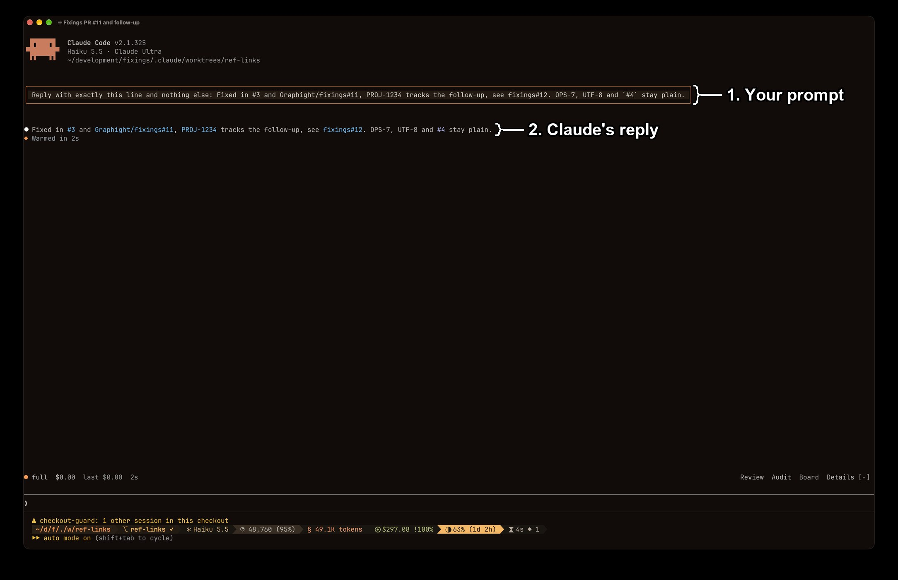

# ref-links

`ref-links` turns ticket, PR and issue references in Claude's replies and in the prompts you type into links you can cmd-click.
Install it with `/plugin install ref-links@fixings`.

## What you're looking at



1. **Your prompt**, drawn by `prompt-tint`.
   `#3`, `Graphight/fixings#11` and `PROJ-1234` are links, and the full pull request URL you typed is drawn as `fixings#12`.
   They carry no colour of their own, so in Ghostty they show only when you hover with cmd held.
2. **Claude's reply.**
   The same four references, drawn as blue links.
   `OPS-7` is not in `projects`, `UTF-8` is not a ticket, and the `` `#4` `` inside a code span stays as written.

## What it links

| Written as | Links to |
| --- | --- |
| `#3` | `https://github.com/<owner>/<repo>/issues/3` for the session's repository; GitHub redirects an issue URL to the pull request when `3` is one |
| `owner/repo#3` | `https://github.com/owner/repo/issues/3`, whatever the session's repository is |
| `PROJ-1234` | `<jiraUrl>/browse/PROJ-1234`, only for a project listed in `projects` |
| `https://github.com/owner/repo/pull/3` | the same URL, drawn as `repo#3` |

The session's repository comes from its remote.
`git@github.com:o/r.git`, `https://github.com/o/r` and `ssh://git@github.com/o/r` are read; any other remote, or no repository, leaves a bare `#3` plain.

## Options

Set them in `/config`.

| Option | Default | Meaning |
| --- | --- | --- |
| `jiraUrl` | empty | base URL of your Jira, such as `https://example.atlassian.net` |
| `projects` | empty | comma-separated project keys to link, such as `PROJ,OPS` |

Jira keys link only when both are set, so `UTF-8` and `SHA-256` never link.

## If you use skins or prompt-tint

`ref-links` rewrites a reply before the next mod draws it, and walks a prompt after the next mod has drawn it.
A copy loaded with `--plugin-dir` linked both beside `skins` 0.5.16, `prompt-tint` and `copy-visible`; an installed copy at the end of `enabledPlugins` has not been checked.
If links are missing after installing, move its line above the `skins` and `prompt-tint` lines in your settings file:

```json
"enabledPlugins": {
  "ref-links@fixings": true,
  "prompt-tint@fixings": true,
  "skins@hellosverre-mods": true
}
```

## What it leaves alone

- Anything inside an inline code span or a fenced block.
- Text already inside a markdown link or an autolink.
- A reference with a word character right before or after it: `abc#3`, `foo.md#3a` and `XPROJ-1` stay plain.
- Notifications and messages from teammates; only prompts you type are linked.
- Tool output and slash-command output.

## Known limits

- Prompts link only when `prompt-tint` draws them.
  Claude Code's own prompt row does not come back as a tree `ref-links` can split, so without `prompt-tint` only replies link.
- A link in a prompt has no colour or underline of its own; Ghostty shows it on cmd-hover.
- A number after `#` outside code links as an issue, so an all-digit colour such as `#000000` written in prose links to issue 0.
- A non-GitHub remote links nothing but `owner/repo#N`, Jira keys and GitHub URLs.
- There is no hover preview of a linked ticket.

## What was checked

- `claude plugin test plugins/ref-links` covers each reference form, the three remote spellings, a non-GitHub remote and no repository, code spans and fences, existing links, the word boundaries, Jira with and without config, and typed, plain and notification prompts.
- Live on 2026-11-13, Claude Code 2.1.325, loaded with `--plugin-dir` and `jiraUrl` `https://example.atlassian.net`, `projects` `PROJ`, the raw terminal output was grepped for OSC 8 links:
  - alone: the reply carried the four links and the prompt none;
  - beside `prompt-tint`, and beside the full set of `skins` 0.5.16, `prompt-tint` and `copy-visible`: the prompt and the reply each carried all four.
- In Ghostty, a cmd-click on `#3` opened issue 3 and on `PROJ-1234` opened `https://example.atlassian.net/browse/PROJ-1234`.
- Not checked: an installed copy, a fenced block or table in a live reply, and terminals other than Ghostty.
