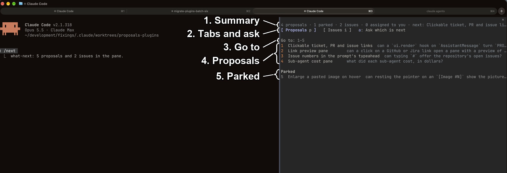
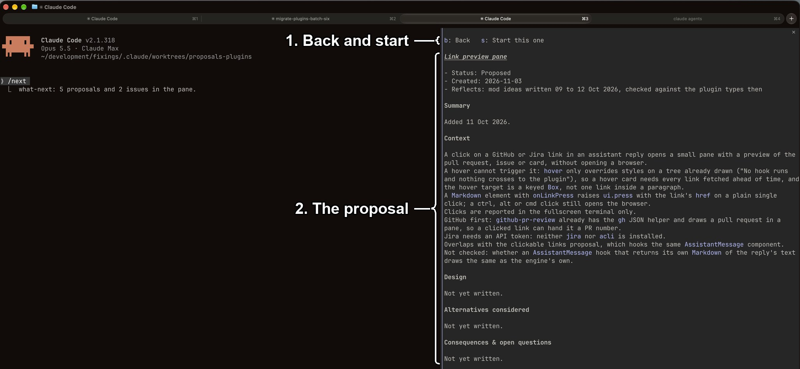
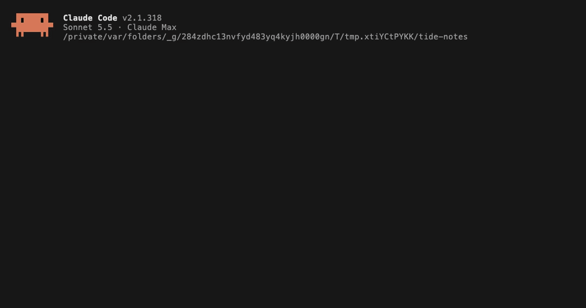

# what-next

`what-next` lists a project's proposals and open issues in the `/next` pane.
Install it with `/plugin install what-next@fixings`.

## What you're looking at

1. **Summary.**
   Counts of open and parked proposals, open issues and the ones assigned to you, then the first proposal that is not parked.
   See [Summary and ask](#summary-and-ask).
2. **Tabs and ask.**
   `p` and `i` switch between proposals and issues; `a` fills the prompt with a request to pick the next one.
   See [Summary and ask](#summary-and-ask).
3. **Go to.**
   Type a row's number to open it.
   See [Rows and tabs](#rows-and-tabs).
4. **Proposals.**
   One row per entry of `docs/proposals/README.md`, in its order: number, name and the first sentence of its note.
5. **Parked.**
   Entries under a `Parked` heading, drawn dim and left out of the ask.

1. **Back and start.**
   `b` returns to the list; `s` fills the prompt with a request to plan this one with `/checkpoint-plan`.
   See [The reader](#the-reader).
2. **The proposal.**
   The proposal's file drawn as Markdown, or an issue's title and body.

The demo recorder in `tools/demo/what-next/` opens `/next` in a throwaway project with a stub `gh` on the PATH, switches to the issues tab and back, opens a proposal in the reader and goes back with `b`, shown at 2× speed:

## Rows and tabs

The proposals are the entries of `docs/proposals/README.md` in README order, in either of two shapes: `1. [Title](slug.md): note` or a bullet with the slug in backticks.
Entries under a heading containing "Parked" are drawn dim under a `Parked` heading.
The issues come from `gh issue list --json number,title,body --limit 100`, run with a 10 second timeout.
A `gh` that is missing, exits non-zero, times out or prints something other than a JSON array leaves the issues source absent, and the pane draws no error.
Each row is a zero-padded number, the name and the first sentence of the note; for an issue those are the issue number, the title and the first non-empty line of the body.

When both sources are present, a strip above the list holds a `Proposals` and an `Issues` Button, each with its hotkey (`p`, `i`) dim beside the label; the current tab is drawn as the primary Button and the other dim, and `/next` opens on Proposals.
With one source there is no strip, and the pane opens on that source.
Typing a number of full width in the `Go to` field opens that row, Enter opens a shorter number, and Tab and Enter work on the names.
On the proposals tab the number is the row's position; on the issues tab it is the issue number.
Switching tabs clears the field.

## Summary and ask

A dim summary line at the top, drawn whenever a source has an entry, gives these parts in order: the proposals not parked, the parked proposals, the open issues (`100+` at the limit), the issues assigned to you, and `next:` with the name of the first proposal that is not parked.
The assigned count comes from a second `gh issue list --assignee @me --json number --limit 100`.
A part is left out when its source is absent or it does not apply.
`a: Ask which is next` is drawn whenever there is a proposal that is not parked or an open issue, after the tabs or alone on that row when there is no strip.
It fills the prompt with `Which of these should I do next, and why? Recommend one.`, then a `Proposals:` section with one `<number>. <name>: <first sentence>` line for each proposal not parked and, when there are open issues, the line ``Issues: read the open ones with `gh issue list`.``
Parked proposals are left out, and the proposals keep the numbers the pane draws.
The button closes the pane without sending the text, and the mod makes no model call.
Typing `p`, `i` or `a` into the `Go to` field does what the matching Button does, because every printable key goes to the field while it holds the focus, so a Button's hotkey does not fire there.

## The reader

The reader draws a proposal's file as Markdown, or for an issue `# #<n> <title>` over the body already fetched; `b` goes back to the list.
`s` fills the prompt with `This session we are doing the "<name>" proposal, please /checkpoint-plan` or, for an issue, ``This session we are doing issue #<n> (read it with `gh issue view <n>`), please /checkpoint-plan``, and closes the pane without sending it.
The `/checkpoint-plan` in that text names the `checkpoint-plan` plugin in this marketplace, which you install separately, and the prompt is never sent for you.
No issue title or body is written into the prompt box.
An issue is text from whoever opened it, and text in the prompt box is sent as the person's own words, so the model reads an issue only as the output of a `gh` call.

## Layout and Desktop

In the fullscreen TUI (`"tui": "fullscreen"`) the engine docks the pane beside the transcript from 110 columns; on the main screen it draws inline above the prompt at any width.

On Desktop the tabs are a primary and a secondary Button with the row count beside each label, and the ask Button sits on the same row.
The summary line and the `Go to` field follow, with a plain `1–N` placeholder, or `#` on the issues tab.
Each row is a right-aligned number in a column as wide as the widest number, beside the name Button with its question beneath it in dim text.
A `Parked` heading precedes the parked rows, which are drawn dim.

## Empty panes

When there is nothing to list the pane draws one line: `No docs/proposals/README.md, and gh issue list gave no issues.` when both sources are absent, `No open issues.` for an empty issues tab, or `No proposals listed in docs/proposals/README.md.` for an empty proposals tab.
The first is the whole pane, and so is either of the others when its source is the only one present.
When both sources are present, the line is drawn under the strip, with the summary and the ask Button above it only when the other source has entries.
The command is registered where `docs/proposals/README.md` exists or the session's repository has an `origin` remote.

## What was checked

On 2026-11-04 a live session loaded this plugin from the checkout with `--setting-sources project,local --settings '{"tui":"fullscreen"}' --plugin-dir plugins/what-next` and ran `/next` in fixings, which is the pair of screenshots above.
The pane docked beside the transcript and drew `4 proposals · 1 parked · 2 issues · 0 assigned to you · next: Clickable ticket, PR and issue links`, the tabs, rows 1 to 4 and entry 5 under `Parked`; opening a row drew its proposal in the reader.
The same session without the `--settings` flag ran on the main screen and drew the pane inline above the prompt.
The issues tab, `a` and `s` were not exercised in that session.
The demo recorder then drew the issues tab from a stub `gh` (`2 issues · 1 assigned to you`, rows 3 and 5) and switched back with `p`, then opened row 1 with Enter and returned with `b`.

Before the port, it was checked on 10 Oct 2026 in a live session, except for `/next` with `gh` signed out.
For that case `GH_TOKEN=x gh issue list` was checked to exit 1 with a 401, and a test covers a non-zero exit leaving the issues source absent.
The prompt text for issues was changed after the live check and has been run only under `claude plugin test`.

VS Code is not a target for this mod.
